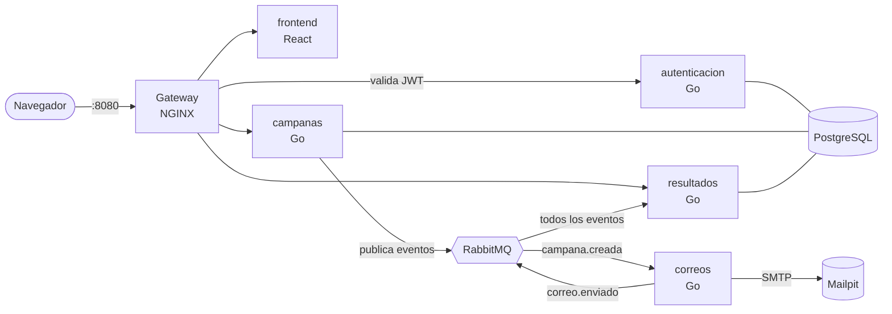

# BulkPhish

Plataforma web para **simular campañas de phishing** y **capacitar a los empleados** en el momento exacto en que cometen el error. Un administrador lanza una campaña de práctica, el sistema envía correos simulados, registra quién hace clic y quién reporta el mensaje, y muestra los resultados en vivo por área y por tipo de ataque.

Los correos nunca salen a Internet: llegan a un buzón de pruebas ([Mailpit](https://github.com/axllent/mailpit)).

## Qué puede hacer

- **Campañas de práctica** con cuatro tipos de ataque: restablecimiento de contraseña, factura pendiente, paquete retenido y beneficio de Recursos Humanos.
- **Segmentación por área**: se elige a qué áreas de la organización se envía cada campaña.
- **Seguimiento por persona**: clics y reportes, con un mosaico visual de «quién hizo qué» que se actualiza cada 3 segundos.
- **Capacitación inmediata**: quien hace clic aterriza en una página que le explica las señales de alerta que podía detectar.
- **Botón «Reportar phishing»** en el correo simulado: reportar también se registra y se mide.
- **Estadísticas**: tasa de clic y de reporte global, por campaña, por área y por tipo de ataque.
- **Acceso protegido** con inicio de sesión y JWT; gestión de empleados desde el panel.

## Arquitectura en una imagen



Es una arquitectura **distribuida y orientada a eventos**: cuatro servicios en Go, cada uno en su contenedor, que se comunican a través de RabbitMQ y no se llaman entre sí. El detalle completo está en [`doc/ARQUITECTURA.md`](doc/ARQUITECTURA.md).

| Servicio | Responsabilidad |
|---|---|
| **gateway** (NGINX) | Única entrada. Enruta, valida la sesión y separa rutas públicas de protegidas. |
| **frontend** (React) | Panel del administrador y páginas públicas de capacitación. |
| **autenticacion** (Go) | Inicio de sesión, emisión y validación de JWT. |
| **campanas** (Go) | Campañas, empleados, registro de clics y reportes, publicación de eventos. |
| **correos** (Go) | Consume eventos y envía los correos simulados. |
| **resultados** (Go) | Consume eventos, calcula las estadísticas y las expone al panel. |

## Tecnologías

| Capa | Tecnología |
|---|---|
| Backend | Go 1.22 · `net/http` · pgx · golang-jwt · amqp091-go · bcrypt |
| Frontend | React 18 · TypeScript · Webpack 5 |
| Mensajería | RabbitMQ 3.13 |
| Base de datos | PostgreSQL 16 |
| Gateway | NGINX 1.27 |
| Correo de pruebas | Mailpit |
| Contenedores | Docker · Docker Compose |

## Inicio rápido

**Requisitos:** Docker con Docker Compose (Docker Desktop en Windows o macOS). No hace falta instalar Go ni Node.

```bash
git clone <url-del-repositorio>
cd bulkphish

# 1. Crear el archivo .env con claves aleatorias (una sola vez)
./scripts/generar-env.sh            # Windows (PowerShell): .\scripts\generar-env.ps1

# 2. Levantar todo el sistema
docker compose up --build
```

El repositorio **no contiene contraseñas**: el paso 1 genera un archivo `.env` con claves únicas y aleatorias y te muestra la contraseña del administrador una sola vez (también queda dentro de `.env`). Sin ese archivo, `docker compose` se detiene con un mensaje que lo indica.

La primera vez tarda unos minutos porque compila los servicios. Cuando termine:

| Qué | Dirección | Credenciales |
|---|---|---|
| **Aplicación** | http://localhost:8080 | `admin@bulkphish.test` y la contraseña generada |
| Buzón de pruebas (Mailpit) | http://localhost:8025 | — |
| Panel de RabbitMQ | http://localhost:15672 | `bulkphish` y `RABBIT_CLAVE` de tu `.env` |

Todos los puertos escuchan **solo en tu máquina** (`127.0.0.1`). Para abrir el gateway a tu red local, define `BIND_GATEWAY=0.0.0.0` en `.env`.

### Probar el flujo completo

1. Entra a http://localhost:8080 e inicia sesión.
2. Ve a **Campañas → Nueva campaña**, elige un tipo de ataque y una o varias áreas, y lanza la campaña.
3. Abre el buzón en http://localhost:8025: llegaron los correos simulados.
4. Abre uno y haz clic en el botón del mensaje. Verás la página de capacitación.
5. Vuelve al panel: en el detalle de la campaña, la celda de esa persona se pone **roja**.
6. En otro correo, usa **«Reportar phishing»** de la barra superior: la celda se pone **verde**.

También puedes ejecutar el recorrido automáticamente con `./scripts/prueba_humo.sh` (con el sistema levantado).

### Apagar y limpiar

```bash
docker compose down        # detiene el sistema y conserva los datos
docker compose down -v     # detiene el sistema y borra los datos
```

## Solución de problemas

| Síntoma | Causa y solución |
|---|---|
| Los servicios repiten `password authentication failed for user "rol_..."` y el log de postgres dice `Skipping initialization` | Hay un volumen de datos de una ejecución anterior con otras contraseñas. Ejecuta `docker compose down -v` y vuelve a levantar. |
| `docker compose` se detiene con `Falta JWT_SECRETO` (o similar) | No existe el archivo `.env`. Ejecuta `./scripts/generar-env.sh`. |
| `generar-env.sh` dice que ya existe un `.env` | No sobrescribe el existente. Bórralo si quieres uno nuevo (y ejecuta `docker compose down -v`). |
| El navegador no carga estilos o scripts | La política de seguridad (CSP) es estricta: revisa la consola del navegador. |

## Desarrollo

```bash
# Backend: pruebas unitarias
go mod tidy          # la primera vez, para generar go.sum (commitéalo)
go vet ./...
go test ./...

# Frontend con recarga en caliente (requiere el sistema levantado con Docker)
cd frontend
npm install
npm start            # http://localhost:3000, redirige /api al gateway
```

## Estructura del repositorio

```
cmd/<servicio>/        punto de entrada de cada servicio Go
internal/
  autenticacion/       login y JWT
  campanas/            campañas, empleados, clics, reportes y bandeja de salida
  correos/             envío de correos simulados
  resultados/          modelo de lectura y API de estadísticas
  eventos/             contrato de los eventos
  mensajeria/          cliente de RabbitMQ
  plantillas/          catálogo de ataques simulados y su capacitación
  basedatos/ web/ config/   utilidades compartidas
bd/                    inicialización de PostgreSQL (esquemas, roles, datos de ejemplo)
gateway/nginx.conf     configuración del API Gateway
scripts/               generar-env, revisar-secretos y prueba_humo
frontend/              panel React + TypeScript + Webpack
doc/                   documentación de arquitectura
docker-compose.yml     orquestación de todo el sistema
Dockerfile.servicio    imagen reutilizable para los servicios Go
```

## Configuración

Toda la configuración sensible vive en `.env` (generado por `scripts/generar-env.sh`, ignorado por Git). `.env.ejemplo` documenta cada variable sin incluir valores reales.

| Variable | Para qué sirve |
|---|---|
| `JWT_SECRETO` | Clave con la que se firman las sesiones (mínimo 32 caracteres). |
| `ADMIN_CORREO`, `ADMIN_CLAVE` | Administrador que se crea al primer arranque (la clave debe tener 12 caracteres o más). |
| `CLAVE_BD_*` | Una contraseña de PostgreSQL por servicio. |
| `RABBIT_USUARIO`, `RABBIT_CLAVE` | Credenciales de RabbitMQ. |
| `BIND_GATEWAY` | Dirección donde escucha el gateway (`127.0.0.1` por defecto). |
| `URL_PUBLICA` | Dirección base que llevan los enlaces de los correos. |

> Las contraseñas de PostgreSQL y la del administrador se aplican solo la **primera vez** que se crea la base de datos. Si regeneras o cambias el `.env` después, ejecuta antes `docker compose down -v` (borra los datos) y vuelve a levantar.

## Seguridad en breve

El sistema está diseñado para ser seguro por defecto:

- **Sin secretos en el repositorio:** ninguna contraseña ni clave está escrita en el código ni en `docker-compose.yml`; todo se lee de `.env`, que está en `.gitignore`. Si falta una variable, el sistema no arranca.
- **Mínima exposición:** solo el gateway sirve la aplicación; PostgreSQL y los servicios no publican ningún puerto. Los paneles de RabbitMQ y Mailpit y el propio gateway solo escuchan en `127.0.0.1`.
- **Autenticación en el borde:** el JWT se valida en el gateway antes de llegar a cualquier ruta protegida.
- **Anti fuerza bruta:** límite de peticiones en NGINX y bloqueo temporal tras 5 intentos fallidos de login.
- **Mínimo privilegio:** un esquema y un rol de PostgreSQL por servicio; contenedores sin root, con sistema de archivos de solo lectura y sin capacidades de Linux.
- **Sin filtraciones por logs o caché:** los tokens de los enlaces no se escriben en los registros y las respuestas de la API no se guardan en caché.
- **Cabeceras de seguridad** (CSP, `X-Frame-Options`, `Referrer-Policy`, entre otras) en todas las respuestas.
- Contraseñas con bcrypt; consultas SQL parametrizadas; plantillas con escape automático de HTML; tokens de enlace aleatorios de 128 bits que no dan acceso al panel.

### Antes de subir cambios a GitHub

```bash
./scripts/revisar-secretos.sh
```

Busca archivos `.env`, llaves privadas, tokens y contraseñas escritas en el código. Si alguna vez se sube un secreto por error, **cámbialo de inmediato**: borrarlo del historial de Git no es suficiente.

## Documentación

- [`doc/ARQUITECTURA.md`](doc/ARQUITECTURA.md): explicación a fondo de componentes, flujos, eventos, datos y decisiones.
- [`doc/arquitectura-interactiva.html`](doc/arquitectura-interactiva.html): recorrido interactivo del flujo. Descarga el archivo y ábrelo en el navegador (GitHub no lo ejecuta dentro del repositorio).
