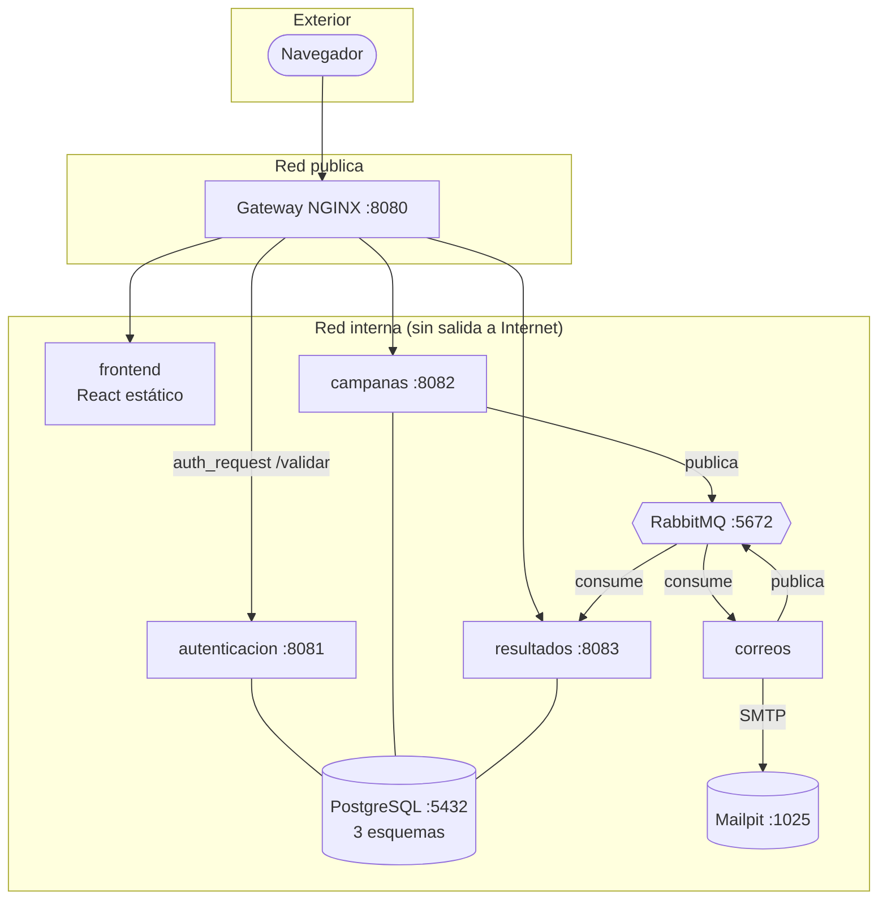
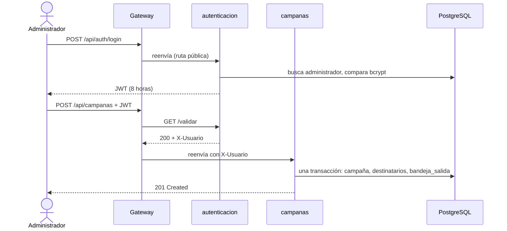
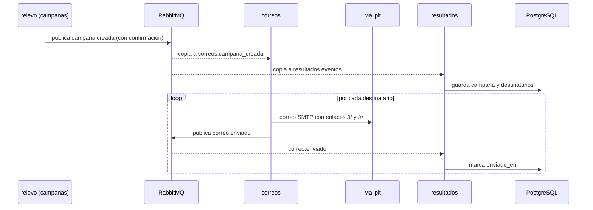
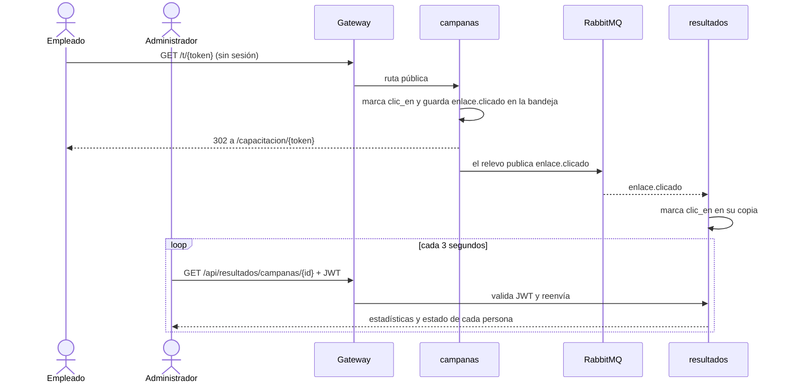
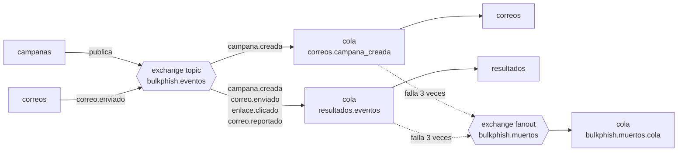
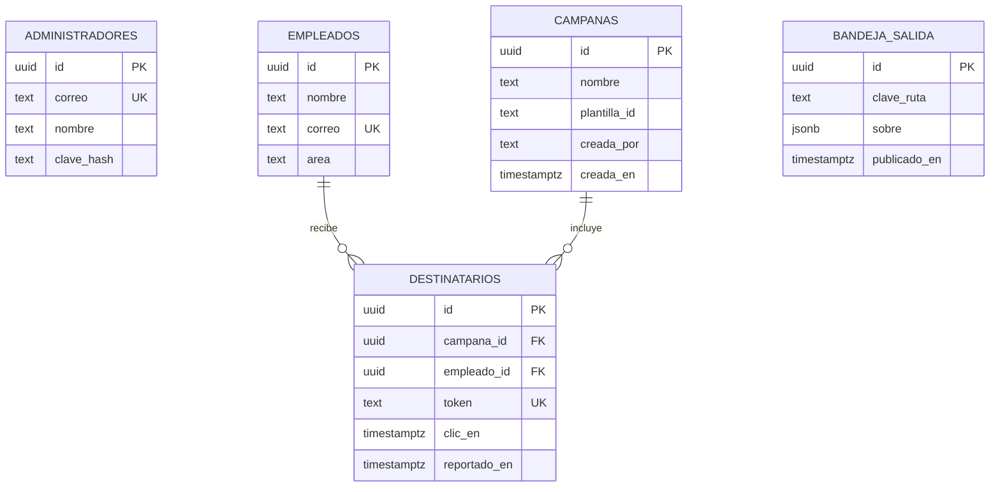

# Arquitectura de BulkPhish

Este documento explica **qué hace cada pieza del sistema, qué tecnología usa, dónde vive en el repositorio y por qué está diseñada así**. Está pensado para entender y defender la arquitectura, no para aprender a escribir el código. Para una vista rápida, lee el [README](../README.md); para recorrer el flujo de forma visual, abre [`arquitectura-interactiva.html`](arquitectura-interactiva.html).

## Contenido

1. [Visión general](#1-visión-general)
2. [Patrones de arquitectura](#2-patrones-de-arquitectura)
3. [Componentes](#3-componentes)
4. [Flujos de ejecución](#4-flujos-de-ejecución)
5. [Mensajería con RabbitMQ](#5-mensajería-con-rabbitmq)
6. [Modelo de datos](#6-modelo-de-datos)
7. [Seguridad](#7-seguridad)
8. [Confiabilidad y manejo de fallos](#8-confiabilidad-y-manejo-de-fallos)
9. [Despliegue con Docker Compose](#9-despliegue-con-docker-compose)
10. [Pruebas y observabilidad actual](#10-pruebas-y-observabilidad-actual)
11. [Decisiones de diseño y límites conocidos](#11-decisiones-de-diseño-y-límites-conocidos)
12. [Glosario](#12-glosario)

---

## 1. Visión general

BulkPhish permite a un administrador de seguridad lanzar **campañas de phishing simuladas**. El sistema envía correos de práctica, registra quién hace clic en el enlace y quién reporta el mensaje, enseña al empleado a reconocer el engaño y entrega estadísticas al administrador.

Está compuesto por **seis contenedores de aplicación** y **tres de infraestructura**:

**Idea central:** el administrador nunca espera a que se envíen los correos. Crear una campaña es rápido (se guarda y se responde) y todo lo demás ocurre en segundo plano, mediante eventos.

## 2. Patrones de arquitectura

| Patrón | En una línea | Dónde se ve |
|---|---|---|
| **API Gateway** | Una sola puerta de entrada que enruta y protege | `gateway/nginx.conf` |
| **Microservicios** | Servicios pequeños, cada uno con una responsabilidad y sus propios datos | `internal/autenticacion`, `campanas`, `correos`, `resultados` |
| **Arquitectura orientada a eventos** | Un servicio publica un hecho y otros reaccionan sin conocerse | RabbitMQ y `internal/eventos` |
| **Publicación/suscripción con fan-out** | Un mismo evento llega a varios consumidores | `campana.creada` llega a `correos` y a `resultados` |
| **Transactional outbox** | El evento se guarda junto con los datos y se publica después, para no perderlo | tabla `bandeja_salida` y `internal/campanas/relevo.go` |
| **CQRS** | Separar quien escribe de quien lee | `campanas` escribe; `resultados` mantiene su propia copia para consultar |
| **Idempotencia** | Procesar dos veces el mismo evento deja el mismo resultado | `resultados` solo fija cada hito la primera vez |
| **Dead-letter queue** | Los mensajes que fallan se apartan para revisarlos | cola `bulkphish.muertos.cola` |
| **Base de datos por servicio (lógica)** | Cada servicio solo toca su esquema | roles `rol_*` en PostgreSQL |
| **Consistencia eventual** | Los datos de lectura se actualizan segundos después | el panel muestra «Preparando…» |

## 3. Componentes

### 3.1 Gateway · NGINX (`gateway/nginx.conf`)

Recibe todo el tráfico en el puerto **8080**, el único puerto de aplicación expuesto. Su trabajo es decidir qué se puede hacer sin sesión y qué no:

| Ruta | Acceso | Destino |
|---|---|---|
| `/api/auth/*` | Público (es el login) | autenticacion |
| `/t/{token}` y `/r/{token}` | Público (enlaces del correo) | campanas |
| `/api/publico/*` | Público (datos de la página de capacitación) | campanas |
| `/api/campanas`, `/api/empleados`, `/api/plantillas`, `/api/areas` | **Requiere JWT** | campanas |
| `/api/resultados/*` | **Requiere JWT** | resultados |
| Cualquier otra ruta de `/api` | — | responde 404 en JSON |
| Todo lo demás | Público | frontend (la app React) |

**Cómo valida la sesión:** con `auth_request`. Antes de reenviar una ruta protegida, NGINX hace una subpetición interna a `autenticacion` (`GET /validar`) con los mismos encabezados. Si responde 200, la petición continúa; si responde 401, NGINX corta y devuelve 401 al cliente. El servicio de autenticación devuelve además el correo del usuario en el encabezado `X-Usuario`, que NGINX reenvía al servicio destino **sobrescribiendo** cualquier valor que el cliente hubiera enviado, de modo que no se puede falsificar.

Además de enrutar, el gateway aplica varias defensas:

- **Límite de peticiones por IP:** 10 por minuto en el login, 60 por minuto en los enlaces del correo y 900 por minuto en la API del panel.
- **Cabeceras de seguridad** en todas las respuestas: `Content-Security-Policy` (solo se ejecuta código y se cargan fuentes del propio sitio), `X-Frame-Options`, `X-Content-Type-Options`, `Referrer-Policy: no-referrer` (el token de un enlace nunca viaja a otro sitio), `Permissions-Policy` y `Cross-Origin-Opener-Policy`.
- **Registros sin secretos:** cada acceso se escribe en JSON con un identificador de petición, y las rutas con token (`/t/…`, `/r/…`, `/capacitacion/…`) se registran como `/t/***`.
- Bloquea el acceso a archivos ocultos y limita los tiempos y el tamaño de las peticiones.
- Corre como usuario sin privilegios, con el sistema de archivos de solo lectura.

### 3.2 Frontend (`frontend/`)

- **Tecnología:** React 18, TypeScript y Webpack 5. Se compila en una imagen Docker de dos etapas: Node 20 compila y el resultado (archivos estáticos) lo sirve un NGINX interno. Node no existe en la imagen final.
- **Páginas del administrador:** Panel (indicadores globales), Campañas, Nueva campaña, Detalle de campaña y Empleados.
- **Páginas públicas:** `/ingresar`, `/capacitacion/{token}` (lo que ve quien hace clic) y `/reportado/{token}` (lo que ve quien reporta).
- **Comunicación:** `fetch` hacia `/api/...` en el mismo origen del gateway, por lo que no se necesita CORS. El JWT se guarda en `sessionStorage` (se borra al cerrar la pestaña) y se envía como `Authorization: Bearer`. Si la API responde 401, la sesión se cierra y se redirige al login.
- **Datos en vivo:** un hook de consulta (`hooks/useConsulta.ts`) repite las peticiones mientras la pestaña está visible: el detalle de campaña cada 3 s, el panel cada 10 s y la lista de campañas cada 8 s.
- **Visualización:** el detalle de campaña muestra un **mosaico** con una celda por persona (roja = hizo clic, verde = reportó, gris = sin acción), barras por área y un gráfico de clics acumulados dibujado en SVG sin librerías de gráficos.

### 3.3 `autenticacion` (`internal/autenticacion`, puerto 8081)

| Endpoint | Función |
|---|---|
| `POST /api/auth/login` | Verifica correo y contraseña y devuelve un JWT |
| `GET /api/auth/yo` | Devuelve los datos del usuario del token |
| `GET /validar` | Lo consulta NGINX; responde solo 200 o 401 |

- Contraseñas guardadas con **bcrypt**. Si el correo no existe se compara contra un hash falso, para que el tiempo de respuesta no revele qué correos están registrados.
- El token es un **JWT HS256** con vigencia de 8 horas y emisor `bulkphish-auth`. Al verificarlo se exige el algoritmo, el emisor y la expiración (un token con `alg: none` se rechaza).
- **Anti fuerza bruta:** tras 5 intentos fallidos desde la misma IP para el mismo correo, bloquea nuevos intentos durante 15 minutos (responde `429`). Un inicio de sesión correcto reinicia el contador.
- Al arrancar crea el administrador inicial con `ADMIN_CORREO` y `ADMIN_CLAVE` si todavía no existe. El servicio **se niega a arrancar** si `JWT_SECRETO` tiene menos de 32 caracteres o `ADMIN_CLAVE` menos de 12.
- Datos: tabla `autenticacion.administradores`.

### 3.4 `campanas` (`internal/campanas`, puerto 8082): el núcleo del negocio

**API protegida:** listar y crear empleados; listar áreas y plantillas; crear, listar y consultar campañas.

**API pública:**
- `GET /t/{token}` registra el **clic** y redirige a `/capacitacion/{token}`.
- `GET /r/{token}` registra el **reporte** y redirige a `/reportado/{token}`.
- `GET /api/publico/capacitacion/{token}` entrega el nombre de pila, las señales de alerta y el consejo de la plantilla.

**Crear una campaña.** En **una sola transacción** de base de datos se guarda: la campaña, un *destinatario* por cada empleado elegido (con un token aleatorio de 128 bits) y el evento `campana.creada` en la tabla `bandeja_salida`. Después responde `201 Created` sin esperar el envío de correos. Si no se eligen áreas, la campaña va a todos los empleados.

**Registrar un clic o un reporte.** Una sola consulta marca la fecha **solo si todavía no estaba marcada** y, en la misma transacción, guarda el evento en la bandeja de salida. Un segundo clic de la misma persona no genera ningún evento nuevo.

**El relevo** (`relevo.go`) es un proceso interno que cada segundo lee la bandeja de salida (hasta 50 eventos con `FOR UPDATE SKIP LOCKED`), los publica en RabbitMQ **esperando la confirmación del broker** y recién entonces los marca como publicados.

Datos: `empleados`, `campanas`, `destinatarios`, `bandeja_salida`.

### 3.5 `correos` (`internal/correos` y `internal/plantillas`)

Es un **consumidor puro**: no tiene API ni base de datos. Escucha `campana.creada` y, por cada destinatario:

1. Toma la plantilla elegida y genera el HTML del correo con el nombre de la persona y dos enlaces: el del cebo (`/t/{token}`) y el del botón «Reportar phishing» (`/r/{token}`).
2. Lo entrega por **SMTP** a Mailpit (hasta 5 envíos en paralelo).
3. Publica `correo.enviado`.

Los correos llevan la cabecera `X-BulkPhish-Simulacro: 1` y cada uno incluye una barra superior que representa el botón de reporte del cliente de correo.

**Plantillas** (`internal/plantillas`): cuatro ataques simulados, cada uno con su correo y su contenido de capacitación (tres señales de alerta y un consejo):

| Plantilla | Tipo |
|---|---|
| Restablecimiento de contraseña | Robo de credenciales |
| Factura pendiente de pago | Fraude financiero |
| Paquete retenido en aduana | Ingeniería social |
| Beneficio exclusivo de Recursos Humanos | Ingeniería social |

El catálogo lo usan dos servicios: `correos` para redactar el mensaje y `campanas` para mostrar la capacitación.

### 3.6 `resultados` (`internal/resultados`, puerto 8083)

Tiene dos funciones en el mismo proceso:

- **Consumidor.** Escucha los cuatro eventos del sistema y mantiene **su propia copia** de campañas y destinatarios. Nunca consulta las tablas de `campanas`.
- **API de solo lectura.** Calcula estadísticas con consultas agregadas sobre esa copia:

| Endpoint | Devuelve |
|---|---|
| `GET /api/resultados/resumen` | Indicadores globales, clics por área, clics por tipo de ataque y las 5 campañas más recientes |
| `GET /api/resultados/campanas` | Lista de campañas con sus tasas |
| `GET /api/resultados/campanas/{id}` | Detalle: tasas, desglose por área y estado de cada destinatario |

La **tasa de clic** es `clics / enviados` y la **tasa de reporte** es `reportados / enviados`. El estado de cada persona se decide por prioridad: `clic` > `reportado` > `enviado` > `pendiente` (quien hizo clic cuenta como fallo aunque después reporte).

### 3.7 PostgreSQL (`bd/`)

Una instancia con **tres esquemas y tres roles**. `rol_campanas` solo puede usar el esquema `campanas`, y así con los demás; cada servicio se conecta con su propio rol y su `search_path` apunta únicamente a su esquema. El script `bd/inicializar.sh` se ejecuta una sola vez, al crear el volumen: crea roles y esquemas, aplica las tablas y carga **24 empleados de ejemplo** en 6 áreas.

### 3.8 RabbitMQ y Mailpit

- **RabbitMQ 3.13:** bus de eventos (ver [sección 5](#5-mensajería-con-rabbitmq)). Panel de administración en el puerto 15672.
- **Mailpit:** servidor SMTP falso. Recibe los correos simulados (puerto interno 1025) y los muestra en una bandeja web (puerto 8025).

### 3.9 Código compartido (`internal/`)

| Paquete | Qué contiene |
|---|---|
| `eventos` | Los tipos de evento y el sobre común. Es el contrato entre servicios. |
| `mensajeria` | Cliente de RabbitMQ: publicar con confirmación, consumir con reintentos, topología. |
| `basedatos` | Conexión a PostgreSQL con reintentos al arrancar. |
| `web` | Respuestas JSON, lectura segura del cuerpo, registro de peticiones, recuperación de errores y apagado ordenado. |
| `config` | Lectura de variables de entorno y logs en JSON. |

Los cuatro servicios se compilan desde un mismo módulo Go: `cmd/<servicio>/main.go` es el punto de entrada de cada uno, y `Dockerfile.servicio` construye cualquiera de ellos con el argumento `SERVICIO`.

## 4. Flujos de ejecución

### 4.1 Inicio de sesión y creación de una campaña (síncrono)

### 4.2 Envío de correos y cálculo de resultados (asíncrono)

### 4.3 Clic de un empleado y lectura del panel

El **reporte** (`/r/{token}`) sigue exactamente el mismo camino, con el evento `correo.reportado`.

### Qué es síncrono y qué no

| Síncrono (el usuario espera) | Asíncrono (en segundo plano) |
|---|---|
| Iniciar sesión | Publicar el evento en RabbitMQ |
| Validar el JWT en el gateway | Enviar los correos |
| Crear la campaña y responder `201` | Calcular y guardar los resultados |
| Registrar el clic y redirigir | Propagar el clic hacia el panel |
| Consultar el panel | |

## 5. Mensajería con RabbitMQ

### Contrato de eventos

Todos los eventos viajan en el mismo sobre JSON: `id`, `tipo`, `ocurrido_en` y `datos`.

| Evento (clave de enrutamiento) | Lo publica | Lo consumen | Datos principales |
|---|---|---|---|
| `campana.creada` | campanas (vía relevo) | correos, resultados | id, nombre, plantilla, fecha y lista completa de destinatarios (id, token, nombre, correo, área) |
| `correo.enviado` | correos | resultados | campana_id, destinatario_id, enviado_en |
| `enlace.clicado` | campanas (vía relevo) | resultados | campana_id, destinatario_id, ocurrido_en |
| `correo.reportado` | campanas (vía relevo) | resultados | campana_id, destinatario_id, ocurrido_en |

`campana.creada` lleva **todos los datos** que los consumidores necesitan, de modo que ninguno consulta la base de otro servicio. Es un acoplamiento mínimo: solo comparten el formato del mensaje.

### Topología

- Exchange **topic** durable: enruta cada evento por su clave a las colas interesadas.
- Mensajes **persistentes** y colas **durables**: sobreviven a un reinicio de RabbitMQ.
- Cada servicio declara la topología al arrancar; es idempotente, así que el orden de arranque no importa.
- `resultados` usa **una sola cola** para sus cuatro eventos, lo que conserva el orden: `campana.creada` siempre se procesa antes que los `correo.enviado` que la siguen.

### Cómo consume un servicio

1. Recibe un mensaje (hasta 10 por adelantado) y lo procesa **de uno en uno**.
2. Si el procesamiento termina bien, confirma (`ack`).
3. Si falla, lo reintenta hasta **3 veces** con espera creciente (500 ms, 1 s, 2 s).
4. Si sigue fallando, lo rechaza y RabbitMQ lo desvía a `bulkphish.muertos.cola`, donde queda guardado para revisarlo desde el panel de RabbitMQ.

## 6. Modelo de datos

| Esquema | Tablas | Dueño |
|---|---|---|
| `autenticacion` | `administradores` | servicio `autenticacion` |
| `campanas` | `empleados`, `campanas`, `destinatarios`, `bandeja_salida` | servicio `campanas` |
| `resultados` | `campanas`, `destinatarios` | servicio `resultados` |

Las tablas de `resultados` son una **copia propia** construida solo con eventos. `resultados.destinatarios` guarda nombre, correo, área y las tres fechas de cada hito (`enviado_en`, `clic_en`, `reportado_en`). Las estadísticas se calculan con consultas agregadas sobre estas fechas, no con contadores, lo que hace que procesar un evento repetido no altere ningún número.

## 7. Seguridad

El diseño sigue estos principios: **seguro por defecto** (si falta una configuración, el sistema no arranca en lugar de usar un valor débil), **mínimo privilegio**, **defensa en capas** y **no confiar en el cliente**.

### 7.1 Gestión de secretos

| Medida | Detalle |
|---|---|
| **Ningún secreto en el repositorio** | `docker-compose.yml` y el código no contienen contraseñas ni claves. Todo se lee de variables de entorno definidas en `.env`. |
| **Sin valores por defecto** | Compose usa `${VARIABLE:?mensaje}`: si falta una, se detiene y explica cómo generarla. |
| **Claves aleatorias y únicas** | `scripts/generar-env.sh` (o `.ps1`) crea el `.env` con claves criptográficamente aleatorias, una distinta por servicio y por función, con permisos 600. No sobrescribe un `.env` existente. |
| **Se rechazan claves débiles** | `autenticacion` no arranca con un `JWT_SECRETO` de menos de 32 caracteres ni con un `ADMIN_CLAVE` de menos de 12. |
| **Archivos protegidos de Git** | `.gitignore` excluye `.env`, llaves y certificados; `.dockerignore` impide que lleguen a una imagen; `.env.ejemplo` documenta las variables sin valores reales. |
| **Revisión antes de subir** | `scripts/revisar-secretos.sh` busca archivos sensibles, llaves privadas, tokens y contraseñas escritas en el código. |

### 7.2 Superficie de ataque y red

| Medida | Detalle |
|---|---|
| **Un solo punto de entrada** | Solo el gateway sirve la aplicación. PostgreSQL, los servicios Go y el frontend no publican ningún puerto. |
| **Solo en tu máquina** | Gateway, panel de RabbitMQ y Mailpit se publican en `127.0.0.1`. Abrir el gateway a la red exige configurarlo (`BIND_GATEWAY`). |
| **Red interna aislada** | Los contenedores se comunican en una red Docker `interna` sin salida a Internet. RabbitMQ y Mailpit se conectan además a una red `publica` únicamente para exponer sus paneles. |
| **Límite de peticiones** | NGINX frena el abuso del login, de los enlaces del correo y de la API. |
| **Cabeceras HTTP** | CSP, `X-Frame-Options: DENY`, `nosniff`, `Referrer-Policy: no-referrer`, entre otras. |

### 7.3 Identidad y sesiones

| Medida | Detalle |
|---|---|
| **Autenticación en el borde** | JWT validado con `auth_request`. Un token falso, vencido o ausente recibe 401 antes de llegar a cualquier servicio. |
| **Identidad no falsificable** | `X-Usuario` lo fija NGINX tras validar el token y reemplaza cualquier valor enviado por el cliente. |
| **JWT estricto** | Se exigen algoritmo (HS256), emisor y expiración de 8 horas; se rechaza `alg: none`. |
| **Contraseñas** | bcrypt. El login tarda lo mismo si el correo no existe, para no revelar qué cuentas existen. |
| **Anti fuerza bruta** | Límite en NGINX y bloqueo temporal tras 5 intentos fallidos. |
| **Sesión en el navegador** | `sessionStorage` (se borra al cerrar la pestaña) y una CSP que impide ejecutar código ajeno. |

### 7.4 Datos y entradas

| Medida | Detalle |
|---|---|
| **Mínimo privilegio en la base** | Un esquema y un rol por servicio. Se revoca el acceso público a la base y al esquema `public`; solo los tres roles pueden conectarse. |
| **SQL parametrizado** | Ninguna consulta se arma concatenando texto del usuario. |
| **Validación de entradas** | Cuerpos limitados a 1 MB, validación de campos, formato de UUID y de tokens, rechazo de campos desconocidos. |
| **Escape de HTML** | Las plantillas usan `html/template`, que neutraliza HTML inyectado en nombres u otros datos. |
| **Errores genéricos** | Al cliente solo llegan mensajes pensados para el usuario; los detalles técnicos quedan en los logs. |

### 7.5 Que nada se filtre

| Medida | Detalle |
|---|---|
| **Tokens fuera de los logs** | Las rutas con token se registran como `/t/***` en el gateway y `/t/{id}` en los servicios. |
| **Sin secretos en los logs** | Los servicios no escriben contraseñas, claves ni tokens JWT. |
| **Sin caché de la API** | Todas las respuestas JSON llevan `Cache-Control: no-store`. |
| **Sin filtración por `Referer`** | `Referrer-Policy: no-referrer` evita que el token del enlace viaje a otros sitios. |
| **Enlaces del correo** | Token aleatorio de 128 bits de un solo propósito: registra clic o reporte, no da acceso al panel. Los tokens inválidos reciben una respuesta genérica. |
| **Correo contenido** | Los mensajes solo llegan al buzón de pruebas; nunca a destinatarios reales. |

### 7.6 Contenedores y cadena de suministro

| Medida | Detalle |
|---|---|
| **Sin root** | Servicios Go con usuario sin privilegios; gateway y frontend con imágenes `nginx-unprivileged`. |
| **Solo lectura y sin capacidades** | `read_only`, `cap_drop: ALL` y `no-new-privileges` en los servicios Go, el gateway y el frontend. |
| **Límites de recursos** | Memoria y número de procesos acotados para contener un abuso. |
| **Dependencias fijadas** | El frontend se instala con `npm ci` desde `package-lock.json` y con `--ignore-scripts`; las imágenes base llevan versión fija. |

## 8. Confiabilidad y manejo de fallos

| Situación | Qué ocurre |
|---|---|
| RabbitMQ no está disponible al crear una campaña | La campaña y su evento ya están guardados en `bandeja_salida`. El relevo lo publicará cuando RabbitMQ vuelva. |
| El servicio cae después de guardar y antes de publicar | Igual: el evento sigue en la bandeja y se publica al reiniciar. |
| Un consumidor falla procesando un evento | Se reintenta 3 veces; si sigue fallando, va a `bulkphish.muertos.cola`. |
| Llega el mismo evento dos veces | `resultados` solo fija cada fecha la primera vez; no cambia ningún número. |
| Un evento de envío llega antes que `campana.creada` | `resultados` lo rechaza como «destinatario aún no existe» y el reintento lo resuelve. |
| `resultados` está caído | Los eventos esperan en su cola y se procesan al volver. |
| Un empleado hace clic varias veces | Solo el primer clic genera un evento. |
| Se pierde la conexión con RabbitMQ | El servicio termina y Docker lo reinicia (`restart: unless-stopped`). |
| PostgreSQL o RabbitMQ tardan en arrancar | Los servicios reintentan la conexión hasta 60 segundos; además Compose espera a que estén saludables. |
| Se apaga un servicio (`docker stop`) | Termina de forma ordenada: deja de aceptar peticiones y cierra conexiones. |

La garantía de entrega de eventos es **«al menos una vez»**: un evento puede llegar repetido, nunca perderse en silencio.

## 9. Despliegue con Docker Compose

`docker compose up --build` levanta nueve contenedores:

| Contenedor | Imagen | Puertos hacia tu máquina |
|---|---|---|
| gateway | `nginxinc/nginx-unprivileged:1.27-alpine` | **8080** (solo `127.0.0.1`) |
| frontend | construida en `frontend/` | — |
| autenticacion, campanas, resultados, correos | construidas con `Dockerfile.servicio` | — |
| postgres | `postgres:16-alpine` | — |
| rabbitmq | `rabbitmq:3.13-management-alpine` | 15672 (solo `127.0.0.1`) |
| mailpit | `axllent/mailpit` | 8025 (solo `127.0.0.1`) |

- **Imagen de los servicios Go:** compilación en una etapa con `golang:1.22-alpine` y ejecución en `alpine:3.20` solo con el binario, como usuario sin privilegios. Un único `Dockerfile.servicio` sirve para los cuatro servicios.
- **Orden de arranque:** `depends_on` con *healthchecks*. Los servicios HTTP exponen `/salud`; PostgreSQL y RabbitMQ tienen sus propias comprobaciones. El gateway espera a que `autenticacion`, `campanas` y `resultados` estén sanos.
- **Datos persistentes:** volúmenes para PostgreSQL y RabbitMQ. `docker compose down -v` los borra.
- **Configuración:** todas las claves vienen de un archivo `.env` generado con `scripts/generar-env.sh`; no hay valores por defecto.

## 10. Pruebas y observabilidad actual

**Pruebas unitarias** (`go test ./...`): emisión y verificación de JWT (incluye token vencido y firmado con otra clave), bloqueo por intentos fallidos, validez y unicidad de tokens, renderizado de todas las plantillas y escape de HTML, cálculo de tasas, validación de UUID y ocultamiento de tokens en los logs.

**Prueba de extremo a extremo** (`scripts/prueba_humo.sh`): con el sistema levantado recorre login, creación de campaña, llegada de correos, clic, reporte y resultados, y comprueba además que las rutas protegidas exijan sesión, que existan las cabeceras de seguridad y que la fuerza bruta se bloquee.

**Registros:** cada servicio escribe logs estructurados en JSON por la salida estándar (`docker compose logs -f <servicio>`), con el nombre del servicio y la duración de cada petición. El gateway también registra en JSON.

**Inspección manual:** el panel de RabbitMQ (puerto 15672) permite ver las colas, los mensajes pendientes y la cola de mensajes muertos; Mailpit (puerto 8025) permite ver los correos enviados.

## 11. Decisiones de diseño y límites conocidos

**Decisiones**

- **Go en todos los servicios**, con un solo módulo y paquetes compartidos: un solo lenguaje, binarios pequeños y contenedores ligeros.
- **NGINX delega la validación en un servicio de autenticación** (`auth_request`), porque NGINX no verifica JWT por sí solo y así la identidad queda en un único lugar.
- **`resultados` consume y además sirve la lectura** (CQRS): el panel consulta una copia optimizada para leer sin cargar al servicio que escribe.
- **Outbox en lugar de publicar directamente:** evita el problema de «guardé en la base pero no llegué a publicar».
- **Una sola instancia de PostgreSQL con esquemas y roles separados:** mantiene la independencia de datos sin la complejidad de varias bases. Separarlas después es un cambio de configuración.
- **Mailpit como buzón de pruebas:** mantiene el SMTP real en el flujo sin enviar nada fuera.

**Límites conocidos**

- Si un correo individual falla al enviarse, se registra en el log pero no se reintenta; esa persona queda como «sin enviar» en el panel.
- Si `correos` cae a mitad de una campaña, RabbitMQ reentrega el evento completo y algunas personas podrían recibir el correo dos veces. Los resultados no se duplican.
- La sesión vive en `sessionStorage`: se pierde al cerrar la pestaña y no es inmune a un ataque XSS.
- El bloqueo de intentos de login vive en memoria del servicio: sirve para una sola instancia; con varias réplicas habría que compartir los contadores.
- No hay HTTPS: el gateway está pensado para ejecutarse en una máquina local o detrás de un proxy que lo proporcione (en ese caso, activar la cabecera `Strict-Transport-Security` indicada en `nginx.conf`).
- Los empleados se agregan de uno en uno desde el panel (no hay importación masiva).
- Las contraseñas de PostgreSQL se fijan al crear el volumen de datos por primera vez (`bd/inicializar.sh` solo se ejecuta entonces). Cambiar el `.env` después exige recrear el volumen con `docker compose down -v`.
- El JWT se firma con una clave compartida (HS256) y no hay mecanismo de revocación: una sesión robada es válida hasta su vencimiento (8 horas).
- No hay análisis automático de vulnerabilidades en dependencias ni en imágenes; `scripts/revisar-secretos.sh` cubre secretos, no vulnerabilidades.

## 12. Glosario

- **API Gateway:** puerta de entrada única que enruta y protege el acceso a los servicios.
- **JWT:** token firmado que prueba la identidad de quien lo presenta sin consultar la base de datos en cada petición.
- **Evento:** mensaje que describe algo que ya ocurrió (por ejemplo, «se creó una campaña»).
- **Exchange / cola:** el exchange recibe los mensajes y los enruta; la cola los guarda hasta que un consumidor los procese.
- **Fan-out:** un mismo mensaje entregado a varios consumidores.
- **Outbox (bandeja de salida):** tabla donde el evento se guarda junto con los datos para publicarlo de forma segura después.
- **CQRS:** separar el modelo que escribe del modelo que lee.
- **Idempotente:** que repetir la operación no cambia el resultado.
- **Consistencia eventual:** los datos se ponen al día unos instantes después, no al mismo tiempo.
- **Dead-letter queue (cola de mensajes muertos):** cola donde se aparta lo que no se pudo procesar.
